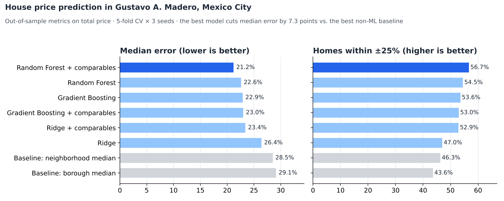

# 🏠 House Price Predictor — Gustavo A. Madero, Mexico City


Machine learning model that estimates the market price of a house for sale in the Gustavo A. Madero borough (Mexico City), built end to end following **CRISP-DM** on a **dataset I collected myself** from three real estate portals.

> The notebook is written in Spanish.

## Key results

- **Random Forest with comparable-home features: 21.2% median error**, vs. 28.5% for the best non-ML baseline (**−7.3 points**).
- **56.7% of homes predicted within ±25%** of their listed price, vs. 46.3% for the baseline.
- Calibrated **80% prediction interval** and a confidence flag when there are few comparable homes nearby.
- Validated with 5-fold cross-validation × 3 seeds, plus GroupKFold by neighborhood to test on areas the model never saw.



## Problem

Mexico has no public record of individual home sale prices, so this project uses **public listings** as asking prices. The model predicts the log of the **price per built m²**, and the final price is price/m² × built m².

## Data

- **2,152 listings** collected from Mercado Libre, Vivanuncios and Lamudi.
- No personal data is stored. The raw and cleaned datasets are **not included** in this repository to respect the portals' terms of use.

Main data quality issues found and handled:

| Issue | Example |
|---|---|
| Foreclosures and rights transfers | Priced far below market value |
| Duplicate listings | The same house posted several times or on several portals |
| Fake locations | Developments in other municipalities listed as GAM neighborhoods |
| Data entry errors | Impossible surface areas, construction year entered as age |
| Inconsistent names | The same neighborhood spelled in different ways |

## Approach

| Step | What was done |
|---|---|
| **1. Integration** | Listings merged into one record per house when price (±1%), built m² (±5%) and neighborhood (or distance < 600 m) match, using union-find |
| **2. Cleaning** | Rule-based exclusion of foreclosures, non-residential listings, fake locations and outliers, with every exclusion logged |
| **3. Comparable features** | Like a real appraiser: smoothed price/m² of the neighborhood and of the 10 nearest homes (BallTree, haversine distance), computed with **cross-fitting** to prevent data leakage |
| **4. Models** | Ridge, Random Forest and Gradient Boosting, each with and without comparables, against two non-ML baselines |
| **5. Validation** | 5-fold cross-validation × 3 seeds, plus GroupKFold by neighborhood |

## Full results

Out-of-sample metrics on total price:

| Model | Median error | Within ±15% | Within ±25% | MAPE |
|---|---|---|---|---|
| **Random Forest + comparables** | **21.2%** | **37.6%** | **56.7%** | **32.3%** |
| Random Forest (no comparables) | 22.6% | 33.8% | 54.5% | 32.5% |
| Gradient Boosting (no comparables) | 22.9% | 33.8% | 53.6% | 33.7% |
| Ridge + comparables | 23.4% | 33.9% | 52.9% | 34.0% |
| Gradient Boosting + comparables | 23.0% | 34.8% | 53.0% | 34.6% |
| Ridge (no comparables) | 26.4% | 28.7% | 47.0% | 37.2% |
| Baseline: neighborhood median | 28.5% | 30.0% | 46.3% | 40.5% |
| Baseline: borough median | 29.1% | 25.7% | 43.6% | 40.7% |

## Project structure

```
├── PREDICTOR-PRECIO-CASAS-GAM-CDMX.ipynb   # full CRISP-DM analysis, executed
├── model_comparison.png                    # figure used in this README
├── requirements.txt
└── LICENSE
```

## How to run

```bash
git clone https://github.com/hgalvaradot/gam-house-price-predictor.git
cd gam-house-price-predictor
pip install -r requirements.txt
```

Place the three listing CSVs in a `data/` folder (or upload them when running in Google Colab):

- `casas_gam_mercadolibre.csv`
- `casas_gam_vivanuncios.csv`
- `casas_gam_lamudi.csv`

Then run all cells of `PREDICTOR-PRECIO-CASAS-GAM-CDMX.ipynb`.

## Limitations

- Prices are asking prices, not closing prices.
- Few listings in lower-income neighborhoods, so intervals are wider there.
- Listings rarely describe the condition of the house.

## Tech stack

Python · pandas · NumPy · scikit-learn · Matplotlib · Google Colab

## Author

**Héctor Giovani García Alvarado** — AI Engineering student, ESCOM-IPN

[LinkedIn](https://www.linkedin.com/in/hector-alvarado-b66a16424) · [GitHub](https://github.com/hgalvaradot)
